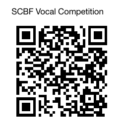

# Youth Vocal Music Competition - 2027

Dear Music Community,

The Santa Cruz Baroque Festival is now accepting applications for its **3rd Youth Vocal Music Competition**.

We invite school students and young adults to participate:

- **Saturday, February 20, 2027** 
- **Trinity Presbyterian Church**
- 423 Melrose Ave. Santa Cruz
- judging slots from **3:00 to late afternoon**

To enter, please complete the entry form at:
[https://docs.google.com/forms/d/e/1FAIpQLSc8N-xEE0E-kWaI1PQNzgvhDAHvZ-6ydKLh5mFgOB1uvQW5og/viewform?usp=publish-editor](https://docs.google.com/forms/d/e/1FAIpQLSc8N-xEE0E-kWaI1PQNzgvhDAHvZ-6ydKLh5mFgOB1uvQW5og/viewform?usp=publish-editor) and send the payment by Saturday, February 13th, 2027, through PayPal: [https://www.paypal.com/ncp/payment/4WB6MCAGJJSJ2](https://www.paypal.com/ncp/payment/4WB6MCAGJJSJ2) or to P.O. Box 482, Santa Cruz, CA 95061

## Categories

The competition has two age categories. The applicant’s age will be their age as of
Jan. 1, 2027

- Young Singer: ages 14-18
- Young Artist: ages 19-26

## Benefits

- Monetary prizes:
  - Young Singers category – $500 to 1st, $300 to 2nd, and $200 to 3rd place.
  - Young Artist category - $200 to 1st, $150 to 2nd, and $100 to 3rd place.
  - Special $100 German-language song award from the artistic director of SCBF, Jörg Reddin
- Feedback from experienced judges.
- 1st place winners will have a performance opportunity at a Baroque Festival Concert
- Award ceremony for winners held at the February 27th concert. Please hold this date (complimentary tickets offered)

## Criteria

- All participants must be residents of Santa Cruz, Santa Clara, San Benito, or Monterey counties.
- Must be between 14 and 26 years old on Jan. 1, 2027.
- Two pieces to be performed in original languages: 
  1. One Baroque song or aria from the Baroque cantata. 
  2. One song in Romantic style.
- Baroque song or aria must be sung in the original key. Memorization is encouraged but not required.
- Time limit: 15 minutes.
- Participants must provide their own piano accompanist.

## Questions? 

Email **vladamuse@sbcglobal.net** or call **(831) 239-4400**

[https://scbaroque.org/youth2/](/youth2/)

Thank you for your interest! 🎵

Vlada Moran, President, Santa Cruz Baroque Festival

